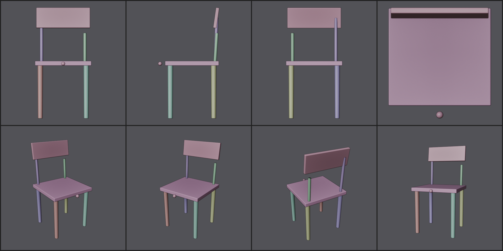
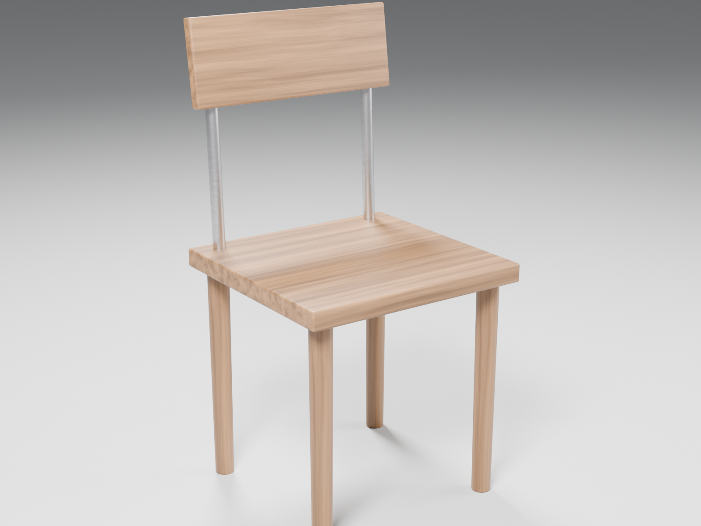

# blender-modeler

An agent skill that makes AI coding agents (Claude Code, OpenAI Codex, and
other tools that read `SKILL.md`) build noticeably better 3D models in Blender.

| Review sheet the agent critiques each round | Final render |
|---|---|
|  |  |

Ask an agent to "model a chair in Blender" and it usually writes one script and
calls it done: wrong proportions, parts floating off the body, sharp CG edges,
flat colours. This skill gives the agent a process and tools instead:

1. **Spec first:** named parts, real-world dimensions, what attaches to what.
2. **One editable model script:** improved round by round, never regenerated.
3. **Measured checks:** a geometry checker finds floating parts, gaps, broken
   meshes and wrong sizes. Vision models are bad at spotting these, so the
   agent gets numbers instead of guessing from pictures.
4. **Fixed review views:** 8 views (4 orthographic, 4 perspective) tiled into
   one sheet, so the agent critiques the same angles every round.
5. **Stages:** blockout → detail → materials → final render, with a gate at
   each stage.
6. **Quality defaults:** builder helpers bevel edges, add subtle material
   variation and run wood grain along each part's length.

The approach follows published research on LLM-driven Blender modelling
(LL3M, VIGA, SEIG, BlenderAlchemy). The common finding is that write → render →
inspect → fix loops, done in stages, beat one-shot generation by a wide margin.

## Requirements

- **Blender 4.2 or newer** (developed and tested on 5.2). 5.1+ is needed for
  the optional live MCP mode.
- **Python 3.8+** on PATH (`python` or `python3`), used only by the launcher.
- An agent that can run commands on your computer: Claude Code, Codex
  CLI/app, or similar. A plain web chat can't run Blender.

## Install

Clone this repo into your agent's skills folder. The folder must be named
`blender-modeler`.

**Claude Code**
```bash
git clone https://github.com/calebrisc/blender-modeler.git ~/.claude/skills/blender-modeler
```

**OpenAI Codex**
```bash
git clone https://github.com/calebrisc/blender-modeler.git ~/.agents/skills/blender-modeler
```

On Windows, `~` is `C:\Users\<you>`. Git Bash and PowerShell both accept `~`
in these commands.

Then check that Blender is found:
```bash
python ~/.claude/skills/blender-modeler/scripts/bmod.py --where
```
If it isn't found, set the `BLENDER_EXE` environment variable to your Blender
executable.

**Update** to the latest version at any time:
```bash
git -C ~/.claude/skills/blender-modeler pull
```
(Use the `~/.agents/...` path for Codex.) Start a new agent session after
installing or updating.

## Use

Just ask, e.g.:

> Model a mid-century walnut side table in Blender, about 50 cm tall, and give me a final render.

The agent writes a spec, builds a blockout, then loops on the check report and
review sheets through each stage. It saves everything under
`~/Documents/BlenderAI/<model-name>/`, including a `model.blend` you can open.

It is strongest on hard-surface subjects: furniture, products, props,
architecture, mechanical parts and cables. Characters, faces, animals and
realistic plants don't come out well from code. For those, the skill tells
the agent to suggest an existing asset and handle the scene around it.

## Optional: live mode (watch it build in your open Blender)

Without this the agent runs Blender in the background, which is all the loop
needs. With it, the agent can also drive the Blender window you have open.
This uses Blender's official MCP server
([Blender Lab](https://www.blender.org/lab/mcp-server/)). You can ask your agent
to do these steps for you.

1. **Get the server** (needs git and Python 3.10+):
   ```bash
   git clone --depth 1 --branch v1.0.3 https://projects.blender.org/lab/blender_mcp.git ~/Tools/blender_mcp
   python -m venv ~/Tools/blender_mcp/venv
   ~/Tools/blender_mcp/venv/bin/pip install ~/Tools/blender_mcp/mcp        # Windows: venv\Scripts\pip
   ```
2. **Install the add-on** into Blender 5.1+. Either drag the zip from the
   [Blender Lab page](https://www.blender.org/lab/mcp-server/) into Blender
   twice (the first drop adds the repository, the second installs), or build
   and install it from the clone:
   ```bash
   blender -c extension build --source-dir ~/Tools/blender_mcp/addon/blender_mcp_addon --output-dir ~/Tools/blender_mcp/dist
   blender -c extension install-file -r user_default -e ~/Tools/blender_mcp/dist/mcp-1.0.3.zip
   ```
3. In Blender: **Edit → Preferences → System → Allow Online Access** must be
   on, or the add-on won't start. It auto-starts on `localhost:9876`.
4. **Register the server with your agent.** The server command is
   `~/Tools/blender_mcp/venv/bin/blender-mcp` (Windows:
   `venv\Scripts\blender-mcp.exe`). Use the full absolute path.
   - Claude Code:
     ```bash
     claude mcp add blender --scope user --env BLENDER_PATH=/path/to/blender -- /full/path/to/blender-mcp
     ```
   - Codex:
     ```bash
     codex mcp add blender --env BLENDER_PATH=/path/to/blender -- /full/path/to/blender-mcp
     ```
     or add this to `~/.codex/config.toml`:
     ```toml
     [mcp_servers.blender]
     command = "/full/path/to/blender-mcp"
     env = { BLENDER_PATH = "/path/to/blender" }
     ```
5. Open Blender first, then start a new agent session.

**Security note from Blender:** the MCP server runs AI-generated code inside
Blender with no sandbox. Save your work before handing over control, and don't
use it on machines with sensitive data.

## Troubleshooting

| Problem | Fix |
|---|---|
| `Blender not found` | set `BLENDER_EXE` to the executable, or pass `--blender PATH` |
| MCP tools missing | start a new session after registering; check the server path is absolute |
| MCP tools time out | Blender must be open, Online Access on, and the add-on preferences should show the server running |
| Port 9876 in use | another Blender MCP add-on (e.g. the community `blender-mcp`) is running; disable one |
| Strange script errors on old Blender | upgrade to 4.2+; the helpers target the 4.2+/5.x API |

## What's in here

```
SKILL.md                  instructions the agent follows
references/techniques.md  modelling craft rules and Blender API gotchas
scripts/bmod.py           launcher: finds Blender, runs one iteration, summarises
scripts/run_pipeline.py   runs inside Blender: build → check → render → save
scripts/check_geometry.py floating parts, gaps, contacts, mesh health, spec checks
scripts/render_views.py   8-view clay/shaded review sheet
scripts/modelkit.py       builders, finishing, materials, studio lighting
```

The scripts also work without an agent:
`python scripts/bmod.py --model your_model.py --out out --mode both`.

## Contributing

Improvements are expected. If you or your agent finds a bug or a missing
helper, open an issue or a pull request. Please:
- test the change with a real `bmod.py` run and include the review sheet if
  it affects visuals,
- add a line to `CHANGELOG.md`,
- keep `SKILL.md` tool-neutral (no app-specific tool names or personal paths).

## License

MIT. See [LICENSE](LICENSE). The optional Blender MCP server is a separate
project by the Blender Foundation (GPL-3.0) and isn't included here.
